데이터와 AI를 연결해 서비스를 구현하는 백엔드 개발자입니다. 
LLM 파인튜닝부터 API 서빙까지, 모델이 실제 서비스에서 동작하도록 만드는 일을 합니다.

## Now

- AICA Financial 7기 수강 중
- 은행 약관을 LLM으로 실행 가능한 조건식으로 바꾸는 프로젝트 진행 중
- 관심 주제: RAG, LLM Fine-tuning, LLM Evaluation

## Projects

**[Clause-to-Rule](https://github.com/yj2025/clause-to-rule)** &nbsp;Python · PyTorch · Transformers · QLoRA

은행 상품설명서 조문을 조건식 JSON으로 변환해 고객별 최종 적용금리를 계산합니다.
LLM은 변환 단계에만 쓰고 분할과 판별은 결정론적 코드로 구현했습니다.
Qwen3-8B QLoRA 파인튜닝으로 검토된 정답셋 기준 정확도를 67.4%에서 79.7%로 올렸습니다.

**[Korean OCR Test](https://github.com/yj2025/korean-ocr-test)** &nbsp;Python · ONNX Runtime · RapidOCR

GPU 없이 한글 문서, 사진, PDF에서 텍스트를 추출하는 경량 OCR 환경입니다.
모델 비교 실험으로 PP-OCRv5 mobile을 선정했고, 이미지당 2-4초에 인쇄체 정확도 95-100%입니다.

**[ADsP Study Room](https://github.com/yj2025/ADsP_study)** &nbsp;Node.js · SQLite · Docker · Caddy

ADsP 시험 대비 학습 웹 앱입니다. 개념 카드, 단원별 문제 풀이, 오답 노트, 시간제한 모의고사를 제공합니다.
이메일 회원가입과 계정별 학습 기록을 지원하며, scrypt 비밀번호 해시, HttpOnly 세션 쿠키, IP별 인증 시도 제한을 적용했습니다.

## Stack

Python · PyTorch · Hugging Face Transformers · QLoRA · Prompt Engineering 
FastAPI · Django · Node.js · PostgreSQL (Supabase) · MySQL · Docker · Kubernetes (KubeSphere) · AWS

## Background

- 명지대학교
- AICA Financial 7기 (수강 중) · Global Academy 7기 · 멋쟁이사자처럼 7기
- 정보처리기사 · ADsP · AICE Basic

Other projects

 

- [godot-yeoul-farm](https://github.com/yj2025/godot-yeoul-farm): Godot 4 농장 경영 시뮬레이션
- [News Digest](https://github.com/yj2025/yj2025_NewsDigest): FastAPI + KoBART 뉴스 요약 서비스
- [OneShot](https://github.com/yj2025/OneShot): 웹 기반 FPS 게임
- [django-jyj-ecommerce](https://github.com/yj2025/django-jyj-ecommerce) · [django-jyj-boards](https://github.com/yj2025/django-jyj-boards) · [django_vote_service](https://github.com/yj2025/django_vote_service): Django 실습
- [JSP_BBS](https://github.com/yj2025/JSP_BBS): JSP 게시판

 

